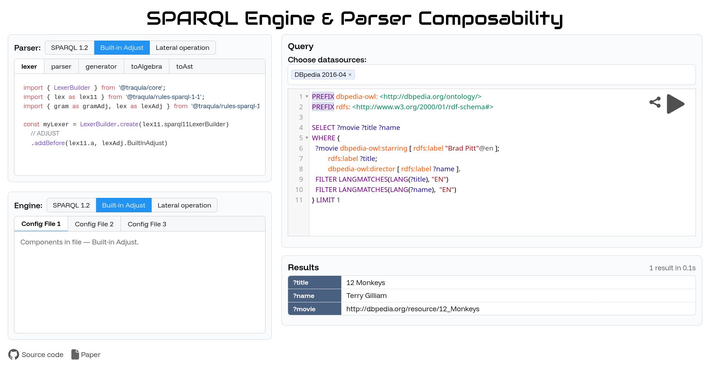

## Demonstration
{:#demo}

In this demonstration, users can interactively configure both the query parsing setup and the query engine they use.
Starting from a SPARQL 1.1 baseline, users may extend the configuration with additional features:
1. SPARQL 1.2 functionality,
2. the built-in ADJUST function, and
3. the lateral operation.

Based on the selected options, the system dynamically generates and displays the corresponding configuration files.
For Traqula, this includes the builders used to construct
the lexer, parser, generator, and the toAst and fromAst transformers, allowing users to observe how the parsing pipeline is adapted.
For the query engine, we expose the relevant configuration files used by Comunica through its dependency injection framework, [Components.js](cite:cites componentsjs).

After configuring both Traqula and Comunica,
users can execute federated queries through an integrated web interface using the selected setup.
During query execution, new functionalities emerge as users experiment with different parser and engine configurations,
showcasing capabilities that are enabled when the components are properly aligned.
This behavior highlights the benefits of composability,
as both the parsing software and the engine work together seamlessly when their configurations match.

<figure id="screenshot" style="display: flex; flex-direction: column">

<figcaption markdown="block">
Screenshot of the web interface demonstrating Traqula and it's integration in Comunica.
</figcaption>
</figure>

